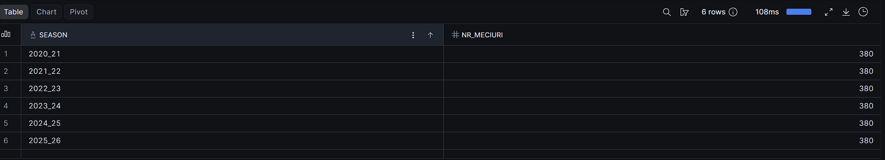
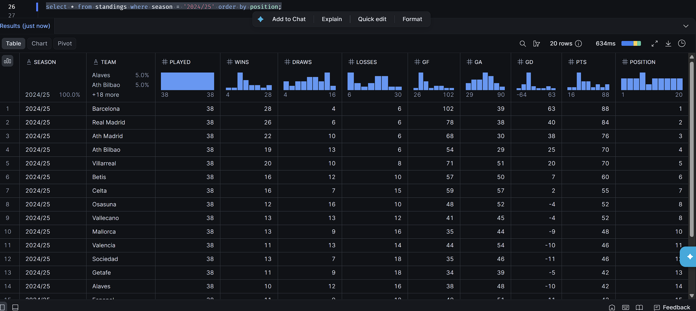
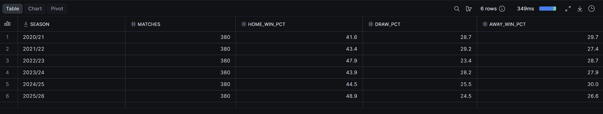
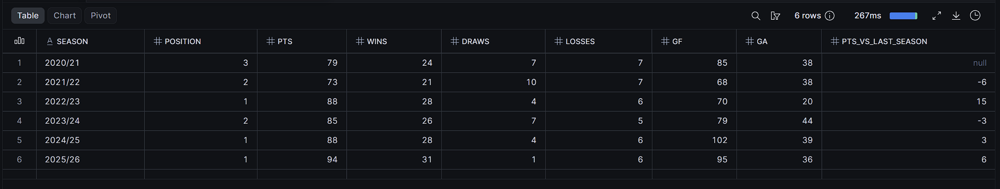
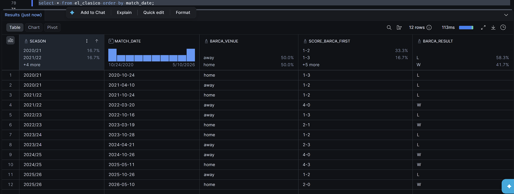
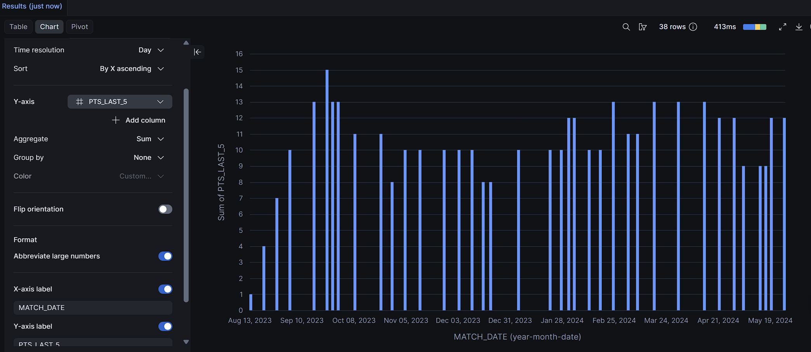

# La Liga analysis in Snowflake

I'm a Barcelona fan, so I wanted to see what the data says about La Liga over the last 6 seasons
(2020/21 – 2025/26). I loaded the match results into Snowflake and answered a few questions with SQL.

Data: [football-data.co.uk](https://www.football-data.co.uk/) – one CSV per season (results, half-time score, shots, cards).

## What I did

1. Loaded the CSV files into a stage and then into a raw table with `COPY INTO`.
   The season is not in the file, so I took it from the file name (`METADATA$FILENAME`).
2. Cleaned the data (real dates, season format, removed empty rows).
3. Split every match into 2 rows (one per team), so standings and team stats are easy to calculate.
4. Wrote views for the questions below.
5. Added a few checks (38 games per team, goals scored = goals conceded, no duplicates).

## Questions

- Standings for every season
- Is there a home advantage? Did it change in 2020/21 without fans?
- How did Barcelona do each season? Home vs away?
- El Clásico – who won more?
- Which teams convert their shots best?
- Which teams come back the most after losing at half-time?
- Barcelona's form over the season (points in the last 5 games)

## What I found

- **Fans matter.** In 2020/21, when games were played without fans, home teams won only 41.6% of matches,
  the lowest of all 6 seasons. After fans came back it went up, to 48.9% in 2025/26.
- **Barcelona won 3 of the 6 titles** (2022/23, 2024/25, 2025/26). In 2022/23 they conceded only 20 goals
  in 38 games, and in 2024/25 they scored 102.
- **El Clásico:** Real Madrid won most of the games until 2024 (Barça lost 6 of the first 8),
  but Barça won both games in 2024/25 (4-0 and 4-3). Overall: 5 wins, 7 losses for Barça.
- 2025/26 was Barça's best season in points: 94, with only 1 draw.

## Screenshots

**Matches per season**


**Standings 2024/25**


**Home advantage per season**


**Barcelona per season**


**El Clásico**



**Barcelona form (points in the last 5 games)**


## Problems I ran into

- One of the files I downloaded had the wrong season inside (2025/26 instead of 2024/25).
  I noticed it because El Clásico showed games from 2025 and 2026 under the 2024/25 season.
  I removed the file from the stage, downloaded the right one and loaded the data again.
- Running the whole SQL file only shows the result of the last query, so I learned to run queries one by one.

## Limitations

- Only 6 seasons and only league games (no Champions League / Copa del Rey).
- When two teams have the same points and goal difference, my standings give them the same position
  (`RANK()`), for example Osasuna and Vallecano in 2024/25. La Liga uses head-to-head results for that.

## What I learned

- Splitting the work into separate SQL files for each step made it easy to fix one step without redoing everything.
- Keeping the raw data untouched and cleaning it into a separate table means I can always rebuild from the source.
- Window functions (`RANK`, `LAG`, `SUM OVER`) are very useful for sports data.

## Files

```
sql/01_setup.sql          database, schemas, warehouse
sql/02_load.sql           stage + COPY INTO
sql/03_clean.sql          cleaned matches table
sql/04_team_matches.sql   one row per team per match
sql/05_analysis.sql       views with the questions
sql/06_checks.sql         data checks
```